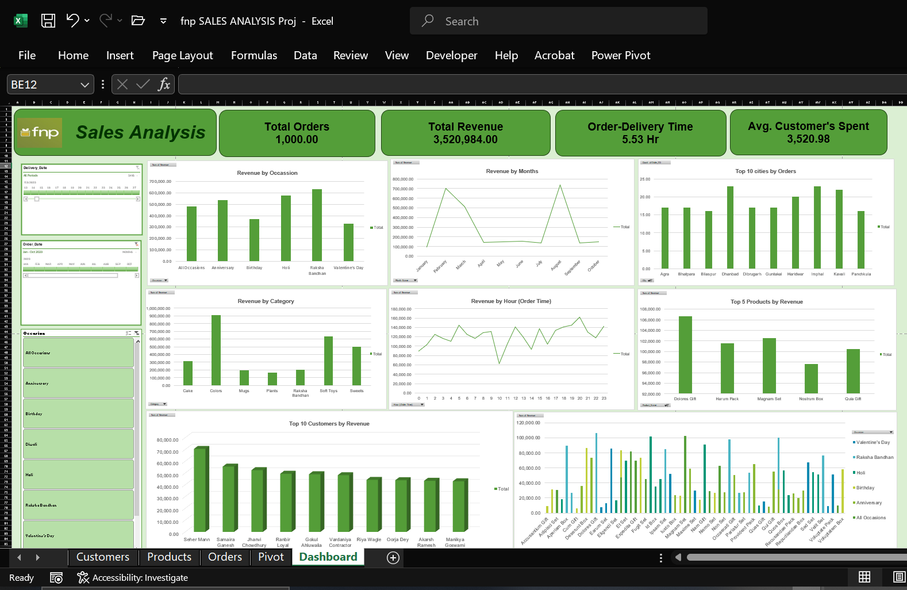

# 🎁 FNP Sales Analysis Dashboard (Excel)

An interactive Excel dashboard that analyses 1,000 gifting orders to show **what sells, when it sells, where it sells and who buys it**. Built with Pivot Tables, Slicers, Timelines and charts, with no code needed.



---

## 📌 Project Overview

| | |
|---|---|
| **Domain** | Retail / E-commerce (gifting) |
| **Tool** | Microsoft Excel |
| **Dataset** | 1,000 orders, 2023  |
| **Type** | Sales and MIS reporting dashboard |

### Problem Statement
A gifting business sells across many occasions, categories and cities, but its order data sits in separate tables. Management needs one view that answers:

- Which occasions, categories and products drive the most revenue?
- Which months and hours see the highest demand?
- Which cities and customers contribute the most?
- How quickly are orders delivered?

---

## 📊 Key Metrics (KPIs)

| Metric | Value |
|---|---|
| Total Orders | 1,000 |
| Total Revenue | ₹35,20,984 |
| Avg. Order Value (AOV) | ₹3,520.98 |
| Avg. Order-to-Delivery Time | 5.53 *[Hr]* |

---

## 🗂️ Data Model

The workbook has five sheets:

| Sheet | Purpose |
|---|---|
| **Customers** | Customer details (ID, name, city, etc.) |
| **Products** | Product name, category, price |
| **Orders** | Order ID, order and delivery date/time, occasion, quantity, revenue |
| **Pivot** | All Pivot Tables behind the charts |
| **Dashboard** | Final interactive dashboard (KPI cards, charts, slicers) |

Tables are linked using lookup formulas (`XLOOKUP` / `VLOOKUP` / `INDEX-MATCH`) *[edit to match what you used]*.

---

## 📈 Dashboard Contents

**Charts**
- Revenue by Occasion
- Revenue by Category
- Top 10 Cities by Orders
- Revenue by Month
- Top 5 Products by Revenue
- Revenue by Hour of Order
- Top 10 Customers by Revenue
- Revenue by Product and Occasion

**Interactive Filters**
- Order Date timeline
- Delivery Date timeline
- Occasion slicer (Anniversary, Birthday, Diwali, Holi, Raksha Bandhan, Valentine's Day, All Occasions)

---

## 🔍 Key Insights

> *Check these against your pivots and edit the numbers before publishing.*

1. **Seasonal peaks:** Revenue peaks in **February** (Valentine's Day) and **August** (Raksha Bandhan), and stays low through most of the middle of the year.
2. **Top occasions:** Anniversary and Raksha Bandhan generate the highest revenue, while Diwali and Valentine's Day are lower despite the seasonal spikes.
3. **Category leader:** **Colors** is the top category, ahead of Soft Toys and Sweets.
4. **Peak ordering time:** Orders and revenue are highest in the **evening (around 7–8 PM)**, so promotions and support staffing can be scheduled around this window.
5. **Top products:** The top 5 products each bring in roughly ₹1 lakh+, led by *Magnam Set*.
6. **Customer concentration:** The top 10 customers contribute a notable share of revenue, which suggests a loyalty or repeat-purchase opportunity.

---

## 💡 Business Recommendations

- Stock up on high-demand categories (Colors, Soft Toys, Sweets) before **February and August**.
- Run time-based offers in the **evening peak window**.
- Introduce loyalty rewards for top customers.
- Investigate cities with high order counts for faster delivery or local fulfilment.

---

## 🛠️ Excel Skills Demonstrated

- Pivot Tables and Pivot Charts
- Slicers and Timelines
- Lookup formulas (`XLOOKUP`, `VLOOKUP`, `INDEX-MATCH`)
- Date and time functions (`MONTH`, `HOUR`, `TEXT`, delivery-time calculation)
- Data cleaning and validation
- KPI cards and dashboard layout design

*[Add or remove items to match your actual workbook, e.g. Power Query, SUMIFS, conditional formatting.]*

---

## 📁 Repository Structure

```
├── Sales_Dashboard.xlsx      # Full workbook with data, pivots and dashboard
├── Sales_Dashboard.png       # Dashboard screenshot
└── README.md
```

---

## ▶️ How to Use

1. Download `Sales_Dashboard.xlsx`.
2. Open it in **Microsoft Excel (2016 or later recommended)**.
3. Go to the **Dashboard** sheet.
4. Use the **timelines and Occasion slicer** to filter the charts.
5. To refresh after changing data: **Data → Refresh All**.

---

## ⚠️ Note

This is a practice project built on a sample dataset to demonstrate analysis and dashboard-building skills. It does not represent real company data.

---

## 👩‍💻 Author

**Gauri** *[add your full name]*
📧 [your email] | 🔗 [LinkedIn URL] | 💻 [GitHub: github.com/Gaurii15](https://github.com/Gaurii15)
